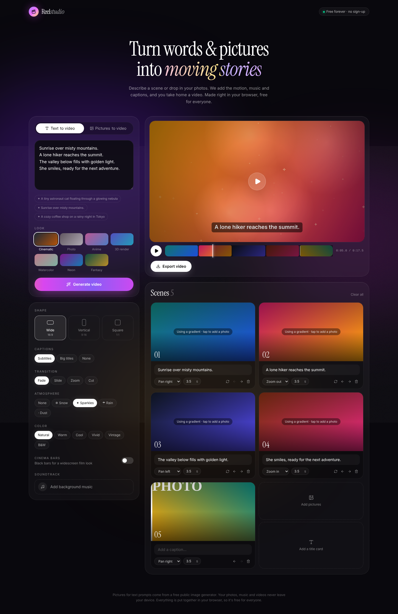

# Reelstudio

A free video maker for everyone. Turn text and pictures into short videos, right in the browser. No sign-up and no paid API keys.



## Features

- **Text to video**: write a prompt or a short script. Each line becomes a scene with an AI picture from a free, key-less image generator ([Pollinations](https://pollinations.ai)). A single sentence becomes a short clip of four shots.
- **Pictures to video**: drop in your own photos and each one becomes a softly moving scene.
- **Make it yours**:
  - Seven looks: Cinematic, Photo, Anime, 3D render, Watercolor, Neon, Fantasy.
  - Wide, vertical or square videos.
  - Camera motion for each scene: zoom in or out, pan left or right.
  - Fade, slide or zoom transitions.
  - Subtitles or big titles.
  - Snow, sparkles, rain or dust effects.
  - Colour looks, cinema bars and background music.
- **Export**: watch a live preview, then **Export video** saves an `.mp4` (or `.webm` in browsers that can't record MP4).

## Why it's free

The video is put together and recorded on the visitor's own device, using the browser's canvas and `MediaRecorder`. Photos, music and finished videos never leave the device, so hosting costs almost nothing. The server's only job is passing picture requests on to the image generator, limited to 30 per minute per visitor.

This is different from Grok or Kling, which create real moving footage with large AI video models that cost money for every clip. Reelstudio animates still pictures instead.

## Getting started

Requires Node.js 20.9 or later.

```bash
npm install
npm run dev
```

Then open http://localhost:3000.

## Deploy

Works on [Vercel](https://vercel.com/new) or any host that runs Next.js, with no environment variables needed. To use a different image service, set `STUDIO_IMAGE_ENDPOINT` (see `.env.example`).

## Browser support

Exporting works best in the latest Chrome, Edge or Firefox. Recording happens in real time, so a 20-second video takes about 20 seconds, and the tab has to stay open while it records.

## Project structure

```
src/app/page.tsx                  The studio page
src/app/api/studio/image/route.ts Picture generator proxy with a per-visitor rate limit
src/components/studio/
  Studio.tsx                      The studio UI
  renderer.ts                     Draws each frame: motion, transitions, captions, effects
  exportVideo.ts                  Records the canvas (and music) into a video file
  types.ts                        Shared types and video sizes
```

## Tech stack

Next.js (App Router), React, TypeScript and Tailwind CSS.
